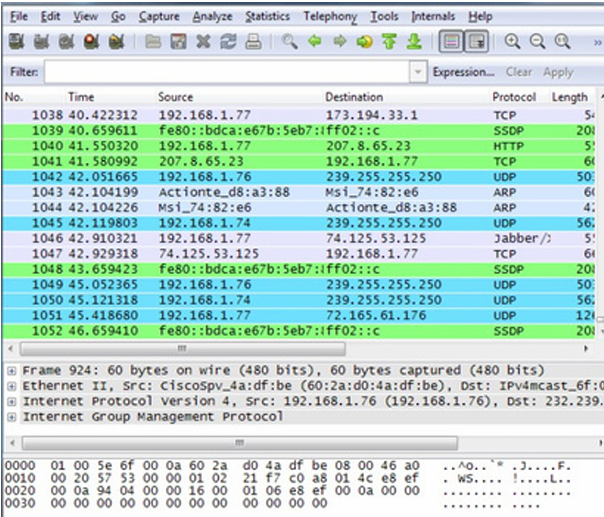
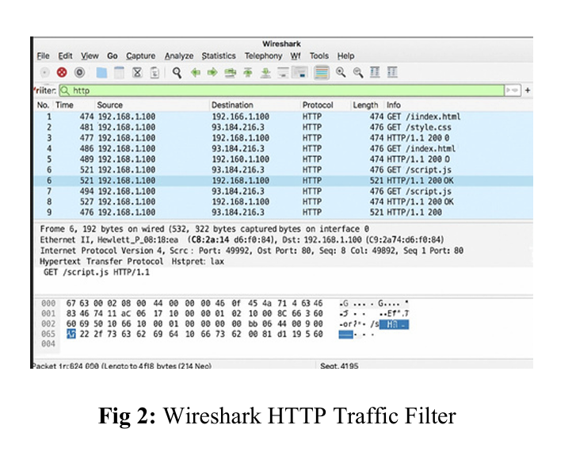
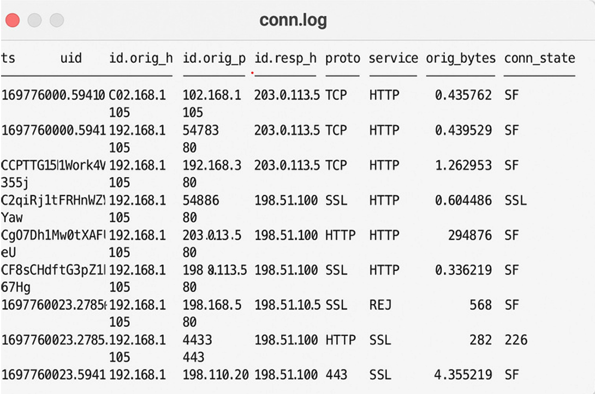
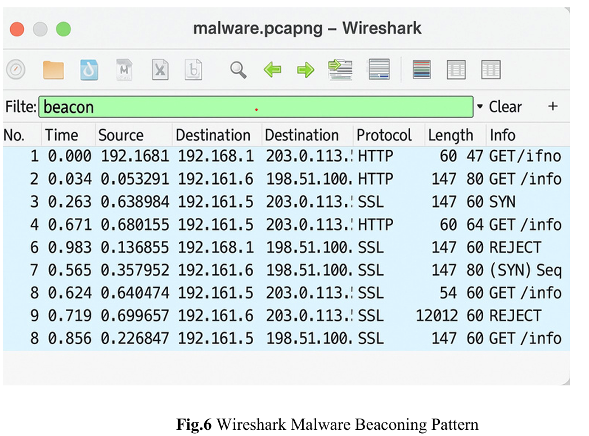
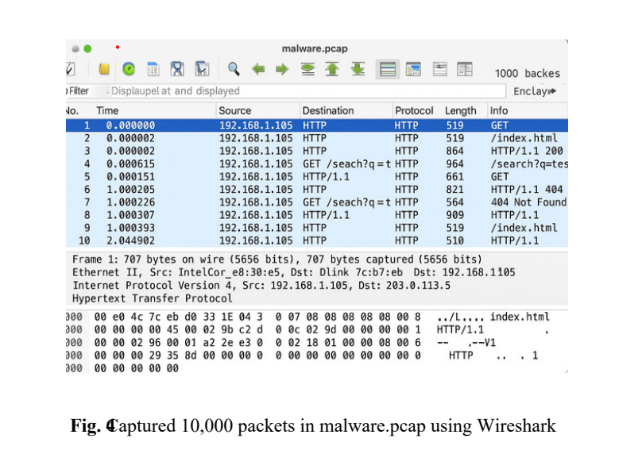

# Network Forensics Using Wireshark & Zeek

## 1. Project Overview

This project focuses on network traffic analysis and digital forensics using Wireshark and Zeek. The objective is to examine network communication, identify suspicious activities and analyse network logs to support cybersecurity investigations.

## 2. Project Objectives

- Understand network traffic analysis.
- Examine network packets using Wireshark.
- Generate and review network activity logs using Zeek.
- Identify suspicious activities and unusual network behaviour.
- Understand the role of network forensics in cybersecurity.

## 3. Tools and Technologies

| Tool | Purpose |
|---|---|
| Wireshark | Network packet capture and analysis |
| Zeek | Network traffic monitoring and log generation |

## 4. Methodology

1. **Network Traffic Analysis:** Captured and examined network packets using Wireshark.
2. **Traffic Investigation:** Reviewed packet information to understand network communication.
3. **Log Generation:** Used Zeek to generate network activity logs.
4. **Forensic Analysis:** Examined network traffic and logs to support investigation of suspicious behaviour.

## 5. Work Performed

- Captured and analysed network packets.
- Investigated suspicious activities and network anomalies.
- Generated network activity logs using Zeek.
- Performed forensic analysis of network traffic.

## 6. Project Outcome

This project improved my understanding of network traffic analysis, packet inspection, network logging and digital forensics.

## 7. Skills Developed

- Network Traffic Analysis
- Packet Inspection
- Network Log Analysis
- Digital Forensics
- Wireshark
- Zeek

## 8. Project Information

- **Project Type:** Academic Cybersecurity Project
- **Tools:** Wireshark, Zeek
- **Focus Area:** Network Security & Digital Forensics

## Project Screenshots

### 1. Wireshark Packet Capture

*Figure 1: Wireshark packet capture interface showing network traffic and packet details.*

### 2. HTTP Traffic Analysis

*Figure 2: Wireshark HTTP traffic filter showing GET requests, HTTP responses and packet details.*

### 3. Zeek Connection Log Analysis

*Figure 3: Zeek conn.log showing network connection details, source and destination IP addresses, protocols, services and connection states.*

**Analysis:**
- Examined network connection records using Zeek.
- Reviewed source and destination IP addresses.
- Inspected TCP connections and HTTP/SSL services.
- Investigated repeated HTTP requests reported in the project.

### 4. Wireshark Malware Beaconing Pattern

*Figure 4: Wireshark traffic view showing the beacon filter and network traffic patterns documented in the original project report.*

**Analysis:**
- Reviewed traffic displayed using the `beacon` filter.
- Observed HTTP and SSL traffic entries.
- Examined source and destination IP addresses.
- Documented the traffic patterns shown in the project report.

### 5. Wireshark Malware PCAP Analysis

*Figure 4: Captured 10,000 packets from malware.pcap using Wireshark.*

## 6. Key Findings

Based on the analysis documented in the original project report:

- Examined network traffic using Wireshark.
- Observed HTTP requests and responses using protocol filters.
- Reviewed source and destination IP addresses.
- Analysed Zeek connection logs (`conn.log`) and HTTP logs (`http.log`).
- Observed repeated HTTP requests and traffic patterns highlighted in the report.
- Reviewed the beacon-filtered traffic shown in the Wireshark screenshots.

## 7. Project Conclusion

This project provided practical academic experience in network traffic analysis and digital forensics using Wireshark and Zeek.

It helped develop an understanding of packet inspection, network connection logs, protocol analysis and identifying potentially suspicious network behaviour.

## 8. Tools and Technologies

- Wireshark
- Zeek
- Network Traffic Analysis
- Digital Forensics
- HTTP and TCP Protocol Analysis

